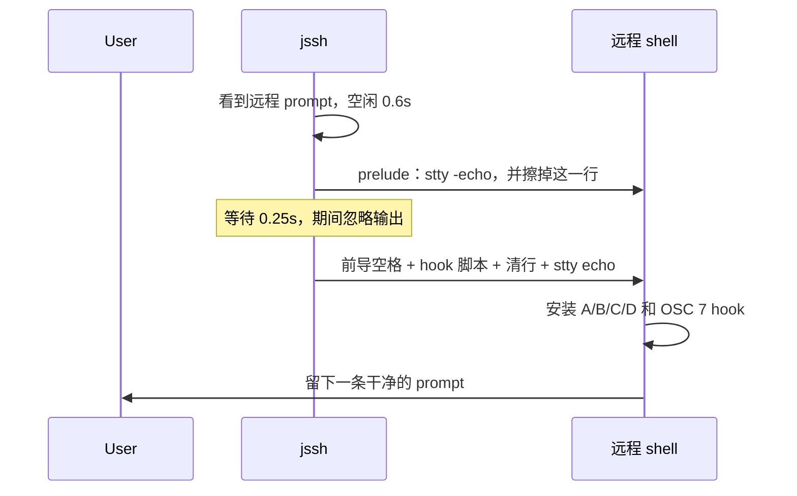

# Otty PS1 注入说明

jssh 用 pexpect 调用本机 `ssh`，经 KoKo 进入资产。这条路径不会经过 Otty 的 `ssh()` wrapper，KoKo 也不会在目标机安装 shell 标记。Otty 的 Cursor Click-to-Move、命令完成标记和远程路径，需要目标 shell 自己发出 OSC 133 和 OSC 7。

因此，在 Otty 里且 MFA 自动填可用时，资产登录完成后，jssh 会向**当前** Bash 或 zsh 会话注入 hook。逻辑对齐 Otty 安装包里的 `ssh-marks.sh`，但不在目标机写临时目录，也不走 Otty 的 ssh bootstrap。

实现在 `src/jssh/connectors/otty_osc133.py`，由 `src/jssh/connectors/session.py` 的 `KokoDriver` 在会话阶段触发。

## 注入不会整段替换 PS1

hook 只在原 `PS1` 末尾追加 OSC 133 `B`（若还没有）。prompt 外观不变。zsh 的 `B` 不改 `PS1`，而在 `zle-line-init` 里发送。

不要改成 `PS1='...'` 整段覆盖。那样会丢掉用户或发行版原有的 prompt，也和 Otty 的 `ssh-marks.sh` 不一致。

## 标记含义

| 标记 | 何时发出 | 作用 |
|---|---|---|
| OSC 133 `A` | 每条 prompt 开始 | 标记 prompt 起点；带 `aid=$$` |
| OSC 133 `B` | prompt 已画完、等待输入 | 标记可点击的输入区 |
| OSC 133 `C` | 用户命令开始执行 | 标记命令输出起点 |
| OSC 133 `D;<退出码>` | 命令结束后、下一条 prompt 前 | 标记命令结束。第一次 prompt 不发 `D` |
| OSC 7 `file://<主机><路径>` | 每条 prompt，与 `A` 一起 | 告诉 Otty 远程当前目录。主机名是 JumpServer **资产主机名**，不是 KoKo |

Bash 4.4 及以上用 `PS0` 发 `C`；更早版本用 `DEBUG` trap，并跳过 hook 自身和补全。退出码必须在 hook 里最先读取，避免被后面的命令改掉。

## 何时会注入

同时满足下面条件才会走带注入的 MFA 会话；否则退回普通 `ssh`，本次连接不注入。

1. `terminal.otty_shell_integration` 为 `auto` 且 `TERM_PROGRAM=otty`，或强制为 `true`。`JSSH_OTTY=0` 会关掉全部 Otty 能力；`JSSH_OTTY_SHELL_INTEGRATION=0` 或 `1` 只覆盖这项。
2. 已开启 TOTP 自动填写，并且当前进程能读到 TOTP 种子。
3. stdin / stdout 是 TTY。
4. 已经离开 KoKo 菜单和口令提示，进入资产上的交互式 Bash 或 zsh。

SFTP 会话不注入。其他终端在 `auto` 下不注入。口令提示出现得很晚、注入命令可能被当成口令时，应关掉自动注入，登录后再手动 `source` 持久化块。

会话命令带守卫：只在交互式 shell、已有 `PS1`、且尚未设置 `__JSSH_OTTY_OSC133_APPLIED` 时执行，避免重复安装。

## 隐藏写入时序

注入命令很长。如果直接 `sendline`，终端上会刷出一长串 escape 和脚本，prompt 也会被打乱。因此分两步发送，并在过程中关掉远端回显。



1. `KokoDriver` 在会话阶段调用 `Osc133Injector.observe()`。仍在 KoKo 界面或口令提示时只取消计时，不发送。
2. 第一次确认已在远程 shell 后，武装 0.6 秒空闲定时器。这段时间内若用户开始键入，本次注入放弃（`note_input`），避免把 hook 和用户输入缠在一起。
3. 空闲到期后先发 prelude（前导空格，避免写入 shell history）：

   `stty -echo 2>/dev/null; printf '\033[A\r\033[2K'`

   关掉回显，并擦掉刚刚发出的这一行。
4. 再等 0.25 秒。**这段时间内 `observe()` 必须忽略后续输出**，否则远程回显或 prompt 刷新会取消定时器，payload 永远发不出去。
5. 再发送 `session_command()`：前导空格 + 会话守卫 + 按 Bash/zsh 选择、用 base64 解码后 `eval` 的 hook，最后是

   `printf '\r\033[2K'; stty echo 2>/dev/null`

   先清掉当前行再恢复回显。没有这一步，旧 prompt 会叠在同一行，下一条 prompt 往往要手动按 Enter 才出现。
6. 若在回显已关掉、payload 尚未发出时取消或关闭会话，只发送 `stty echo 2>/dev/null`，不要再跑清屏后缀。

进入远程 shell 后请稍等再敲命令，好让注入跑完。

## 可选持久化

默认只影响当前会话，不改目标机文件。

把 `terminal.otty_shell_install` 设为 `true` 后，注入成功时会追加写入远程 `~/.bashrc`（先备份为 `~/.bashrc.jssh-otty.bak`），块标记为：

```bash
# >>> JSSH OTTY SHELL INTEGRATION >>>
# ...
# <<< JSSH OTTY SHELL INTEGRATION <<<
```

持久化块目前只覆盖 Bash，不写入 zsh 的 rc。不要默认在生产机上打开这项。卸载：删掉上述标记之间的块，或从备份恢复。

## 相关配置

```yaml
terminal:
  otty_shell_integration: auto   # auto：仅 Otty；true / false：强制
  otty_shell_install: false      # true：写入远程 ~/.bashrc（先备份）
```

环境变量：`JSSH_OTTY`、`JSSH_OTTY_SHELL_INTEGRATION`。

本版本不实现 `ottyd`。

## 改这里时注意

- 不要整段替换 `PS1`。
- 保持 prelude / payload / 回显恢复这三段分离；中途取消只恢复 echo。
- 改注入时序测试时，`ManualClock.fire` 必须把链式定时器一次耗尽。从终端输出里提取 `PS1` 时要去掉 CSI（含 `\x1b[2K`）和 CR。
- 更完整的仓库约束见 [`skills/jssh/SKILL.md`](../skills/jssh/SKILL.md)。
